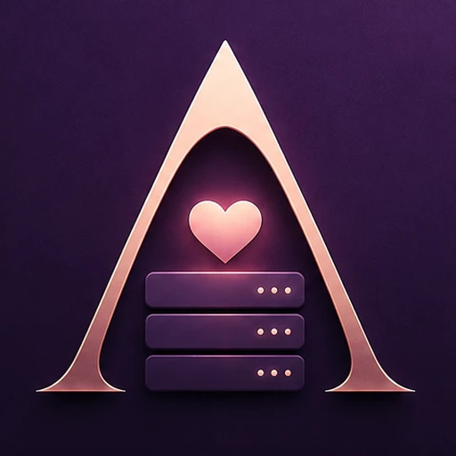

<div align="center">



# Alcove

### A private, self-hosted space for couples and families to bring their Tryst backups together


**Status: early build (M3).** The server runs, starts unattended with its key kept apart from the data, and has accounts, an admin console with a tamper-evident log, uploads of Tryst backups kept as revisions, encrypted instance backups with a tested restore, soft delete with a real purge, and private spaces joined by invite. Sharing views, editing and export come next. The
design documents live in `docs/`.

</div>

---

## What & why

[Tryst](https://github.com/herbiewalker/tryst) keeps private records on one phone, with no cloud and no
network. That is the point, but it makes two things hard: seeing a shared history with a partner, and
fixing entries on something bigger than a phone screen. [Sanctum](https://github.com/herbiewalker/sanctum)
solves the backup half. **Alcove** is the other direction: a small server you run yourself where each
person uploads their backups, edits their entries on a computer, and chooses what to share.

- **In scope (v1):** upload Tryst backups (from your phone's browser over wifi) as immutable revisions · independent spaces for different
  groups · a shared calendar overlay and compare metrics from what each person shares · edit entries on a
  computer and export a fresh `.tryst` to restore on the phone · recover deleted items · an admin console
  with a full, tamper-evident log.
- **Not in scope:** social features, live sync, internet exposure, any change to Tryst. Video waits for
  Tryst to support it.
- **Promises:** a space is collaborative but **nothing leaves it** (consent at join, pause, per-entry private), the server is **LAN only**, it makes **no outbound
  calls** by default, data is **encrypted at rest** with the key kept apart from it, and the admin's
  access is total but **always logged**. Each is meant to be enforced by a CI check where it can be.

> [!WARNING]
> Alcove reads people's decrypted data on the server, and the admin can see everything. That is a
> deliberate trade for a household that trusts its admin, and it is written down in the threat model as
> it is built. It is not a zero-knowledge system. Adults only, invite only.

## Quickstart (development only)

There is no installable release yet. Prerequisites: Go (the pin is in [SETUP.md](SETUP.md)) and Git for
Windows or any POSIX shell.

```powershell
git clone https://github.com/herbiewalker/alcove.git
cd alcove
powershell -NoProfile -ExecutionPolicy Bypass -File .\bootstrap.ps1
```

Expect `BOOTSTRAP GREEN`. The server needs a master key file kept outside its data folder, and it
refuses to start without one:

```powershell
.\bin\alcove.exe keygen -out C:\alcove-dev\keys\alcove.key
$env:ALCOVE_KEY_FILE = "C:\alcove-dev\keys\alcove.key"; $env:ALCOVE_DATA_DIR = "C:\alcove-dev\data"
$env:ALCOVE_TMP_DIR = "C:\alcove-dev\tmp"; $env:ALCOVE_ALLOW_NONTMPFS_TMPDIR = "true"   # dev box only
$env:ALCOVE_ADDR = "127.0.0.1:8080"; .\bin\alcove.exe
```

```bash
curl http://127.0.0.1:8080/healthz
# {"state":"unlocked","status":"ok","version":"dev"}
```

On Linux or in CI, `make check` runs the same gates.

## Documentation map

| Doc | What it owns |
|-----|--------------|
| [CLAUDE.md](CLAUDE.md) | the hard constraints, scope and the contract for an AI pair |
| [SETUP.md](SETUP.md) | toolchain pins, environment, platform trap and fix list |
| [docs/REQUIREMENTS.md](docs/REQUIREMENTS.md) | scope, non-goals, functional and non-functional requirements |
| [docs/ARCHITECTURE.md](docs/ARCHITECTURE.md) | components and data flows |
| [docs/THREAT_MODEL.md](docs/THREAT_MODEL.md) | assets, adversaries, mitigations, accepted risk |
| [docs/DATA_MODEL.md](docs/DATA_MODEL.md) | entities, revisions, retention and migration rules |
| [docs/ROADMAP.md](docs/ROADMAP.md) | milestones and their exit criteria |
| [docs/DECISIONS.md](docs/DECISIONS.md) | the ADR log and open questions |
| [RUNBOOK.md](RUNBOOK.md) | first start, backups, proving the key copy, restoring, locked-out recovery |
| [CRITICAL_ASSETS.md](CRITICAL_ASSETS.md) | what git deliberately does not hold |

## Known limitations

- **Early build.** Accounts, uploads, backups, soft delete, spaces and invites work. Sharing views, the calendar overlay, comparing, editing and export are still plans (see the roadmap).
- **Server-side trust.** The host operator can read the data; there are no per-user keys that hide it from
  the admin.
- **Plain HTTP on the LAN.** Content crosses your home network unencrypted by default (a secured wifi is assumed). HTTPS is available through a reverse proxy or Tailscale, enabled by the admin (R14, D-23).
- **Manual phone round trip.** Edits reach the phone by exporting a backup and restoring it, not by sync.
- **Tied to Tryst's backup format**, which changes with Tryst. Compatibility is a standing maintenance cost.

## License

AGPL-3.0-or-later, see [LICENSE](LICENSE). Alcove implements Tryst's backup format from
[the published spec](https://github.com/herbiewalker/tryst/blob/main/docs/EXPORT_FORMAT.md) rather than
reusing Tryst's code.
